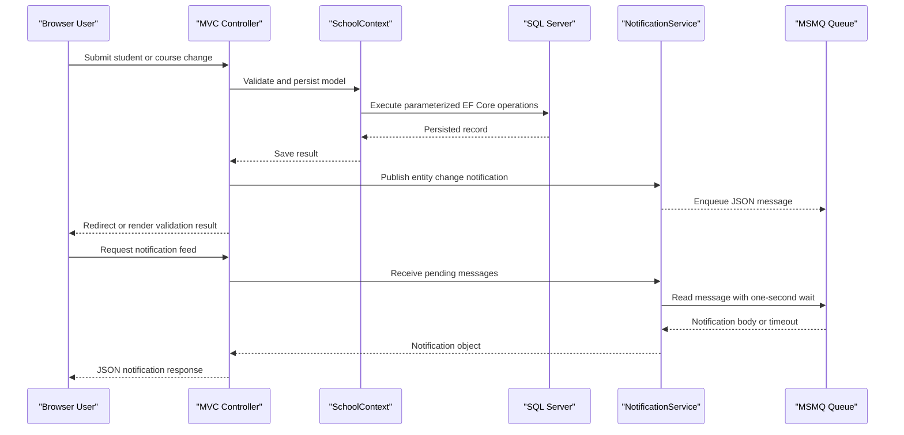

# API & Service Communication Contracts

The application exposes MVC page actions and a small JSON notification interface through one web service. Calls are synchronous within the application, with notification messages placed on a local queue for later retrieval.

## Service Catalog

| Service | Port | Category | Purpose |
|---|---|---|---|
| ContosoUniversity | Not specified | API Layer | Serves MVC pages, performs university-data operations, and exposes notification JSON actions |

## API Endpoints Inventory

The default route is `/{controller}/{action}/{id?}`. MVC actions not marked `[HttpPost]` are conventionally reached with GET; write actions are POST and use anti-forgery validation where present.

| Service | Method | Path | Request Type | Response Type |
|---|---|---|---|---|
| ContosoUniversity | GET | `/Home/Index`, `/Home/About`, `/Home/Contact`, `/Home/Error`, `/Home/Unauthorized` | Optional query values | Razor view |
| ContosoUniversity | GET | `/Students/Index` | Search, sort, filter, page query values | Paginated student view |
| ContosoUniversity | GET | `/Students/Details/{id}`, `/Students/Edit/{id}`, `/Students/Delete/{id}` | `id` route value | Razor view or HTTP error |
| ContosoUniversity | POST | `/Students/Create`, `/Students/Edit/{id}`, `/Students/Delete/{id}` | `Student` model; form fields | Redirect or validation view |
| ContosoUniversity | GET | `/Courses/Index`, `/Courses/Details/{id}`, `/Courses/Create`, `/Courses/Edit/{id}`, `/Courses/Delete/{id}` | Optional `id` route value | Razor view |
| ContosoUniversity | POST | `/Courses/Create`, `/Courses/Edit/{id}`, `/Courses/Delete/{id}` | `Course` model and optional image upload | Redirect or validation view |
| ContosoUniversity | GET | `/Instructors/Index`, `/Instructors/Details/{id}`, `/Instructors/Create`, `/Instructors/Edit/{id}`, `/Instructors/Delete/{id}` | `id`, `courseID` query/route values | Razor view |
| ContosoUniversity | POST | `/Instructors/Create`, `/Instructors/Edit/{id}`, `/Instructors/Delete/{id}` | `Instructor` model and selected course IDs | Redirect or validation view |
| ContosoUniversity | GET | `/Departments/Index`, `/Departments/Details/{id}`, `/Departments/Create`, `/Departments/Edit/{id}`, `/Departments/Delete/{id}` | Optional `id` route value | Razor view |
| ContosoUniversity | POST | `/Departments/Create`, `/Departments/Edit/{id}`, `/Departments/Delete/{id}` | `Department` model | Redirect or validation view |
| ContosoUniversity | GET | `/Notifications/GetNotifications` | None | JSON envelope containing up to 10 queued notifications |
| ContosoUniversity | POST | `/Notifications/MarkAsRead` | Notification `id` | JSON success/error envelope |
| ContosoUniversity | GET | `/Notifications/Index` | None | Razor dashboard view |

## Management & Observability Endpoints

| Service | Endpoint | Custom Metrics |
|---|---|---|
| ContosoUniversity | None identified | No custom metrics or health-check endpoints were found |

## DTOs & Contracts

MVC actions primarily bind directly to domain model classes (`Student`, `Course`, `Instructor`, and `Department`) and return Razor views. `AssignedCourseData`, `InstructorIndexData`, and `EnrollmentDateGroup` are view models used to shape page data. Notification endpoints serialize `Notification` records into JSON; no immutable request/response DTOs, OpenAPI definition, GraphQL schema, or protobuf schema was found. JSON serialization uses Newtonsoft.Json in the queue service and MVC JSON results for notification responses.

## Communication Patterns

Browser-to-application communication uses HTTP through the conventional MVC route. Controllers synchronously call `SchoolContext` and EF Core for database operations. CRUD notifications are serialized and sent to MSMQ; the notification controller later receives them during a request, so there is no separate API call or distributed service choreography. No retry policy, circuit breaker, timeout policy, service discovery, or API gateway was identified. The connection string uses LocalDB integrated security. Web.config enables Windows authentication in IIS Express and disables anonymous authentication, but controller actions do not declare explicit authorization attributes; no TLS deployment policy was identified in the project configuration.

## Service Technology Matrix

| Service | Web | Data Access | Discovery | Gateway | Actuator | Cache | Metrics |
|---|---|---|---|---|---|---|---|
| ContosoUniversity | ASP.NET MVC 5 | EF Core 3.1 / SQL Server | None | None | None | None | None |

## Service Communication Sequence

