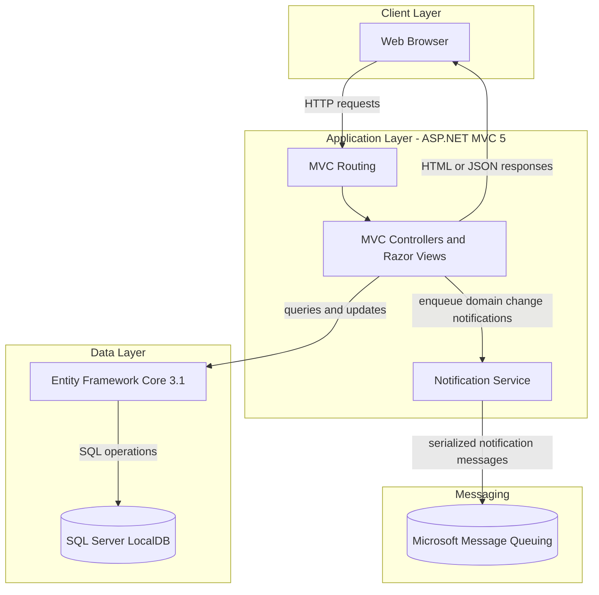
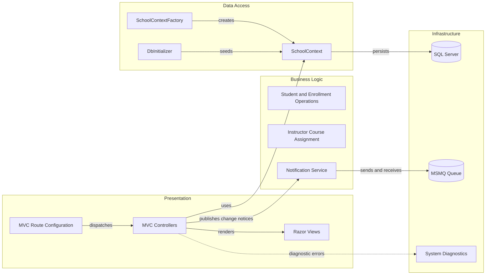

# Architecture Diagram

ContosoUniversity is a single web application for managing university students, instructors, courses, departments, and enrollment records. Its MVC controllers use an EF Core context for SQL Server access and enqueue notifications through Microsoft Message Queuing.

## Application Architecture

### Technology Stack Summary

| Layer | Technology | Version | Purpose |
|---|---|---|---|
| Presentation | ASP.NET MVC | 5.2.9 | Server-rendered pages and controller actions |
| Runtime | .NET Framework | 4.8 | Application runtime |
| Data access | Entity Framework Core | 3.1.32 | ORM and SQL Server access |
| Database driver | Microsoft.Data.SqlClient | 2.1.4 | SQL Server connectivity |
| Messaging | System.Messaging | .NET Framework | Notification queue access |
| UI assets | Bootstrap, jQuery | 5.3.3, 3.7.1 | Browser styling and client-side behavior |

### Data Storage & External Services

The application uses a SQL Server connection configured in `Web.config` (currently LocalDB with integrated security) for domain and notification entities. It also uses a local private MSMQ queue to carry serialized notifications. No separately deployed APIs, caches, or external service endpoints were identified.

### Key Architectural Decisions

- Uses conventional ASP.NET MVC controllers and Razor views in a single deployable web application.
- Creates an EF Core `SchoolContext` for controller operations and initializes seed data at application startup.
- Sends CRUD notifications through MSMQ rather than through an external service or persistent event broker.

## Component Relationships

### Component Inventory

| Component | Layer | Type | Responsibility |
|---|---|---|---|
| `StudentsController` | Presentation | MVC Controller | Student browsing, enrollment summaries, and student CRUD |
| `CoursesController` | Presentation | MVC Controller | Course CRUD and teaching-material image uploads |
| `InstructorsController` | Presentation | MVC Controller | Instructor CRUD and course assignments |
| `DepartmentsController` | Presentation | MVC Controller | Department CRUD and administrator assignment |
| `NotificationsController` | Presentation | MVC Controller | Reads queued notifications and marks notifications as read |
| `SchoolContext` | Data Access | EF Core DbContext | Defines entity sets and model relationships |
| `SchoolContextFactory` | Data Access | Factory | Builds contexts from the configured SQL Server connection |
| `DbInitializer` | Data Access | Seed initializer | Populates initial university data |
| `NotificationService` | Business Logic | Queue service | Serializes and sends notifications; receives and deserializes them |
| `RouteConfig` | Presentation | MVC configuration | Registers the conventional controller/action/id route |
