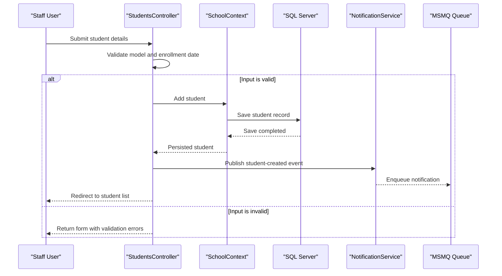

# Core Business Workflows

ContosoUniversity supports school administration: staff maintain student, instructor, course, and department records, and associate students with courses. Changes are reflected in the database and published as notifications for the dashboard.

## Domain Entities

| Entity | Service / Bounded Context | Description | Key Relationships |
|---|---|---|---|
| Student | University administration | Represents a learner and enrollment activity | Inherits from Person; participates in Enrollment |
| Instructor | University administration | Represents teaching staff and assigned courses | Inherits from Person; can have an office and teach courses |
| Course | Curriculum management | Catalog item offered by a department | Has enrollments and instructor assignments |
| Department | Academic organization | Organizational unit responsible for courses | Offers courses and may have an instructor administrator |
| Enrollment | Student registration | Connects a student to a course and records a grade | Links Student and Course |
| CourseAssignment | Teaching assignment | Connects an instructor with a course | Links Instructor and Course |
| OfficeAssignment | Staff directory | Associates an instructor with an office location | One-to-one relationship with Instructor |
| Notification | Operational notifications | Summarizes an entity create, update, or delete event | References changed entity by type and identifier |

## Service-to-Domain Mapping

| Service | Domain Context | Owned Entities | External Dependencies |
|---|---|---|---|
| ContosoUniversity | University administration and curriculum management | Person, Student, Instructor, Course, Department, Enrollment, CourseAssignment, OfficeAssignment, Notification | SQL Server and MSMQ |

The application is a single service with one source of truth in SQL Server. Domains exchange data through shared EF Core relationships rather than remote APIs or events between separate services.

## Primary Workflows

### Workflow 1: Register a Student

1. A staff user opens the student creation page and supplies student information.
2. The controller applies model validation and checks that the enrollment date is within the SQL Server-supported range.
3. If validation succeeds, the controller saves the Student through `SchoolContext`.
4. The controller sends a Student-created notification and redirects to the student list.
5. If validation fails, the form is returned with validation messages; if persistence fails, a diagnostic entry is recorded and the user receives a generic error.

### Workflow 2: Assign Courses to an Instructor

1. A staff user submits the instructor form with selected course identifiers.
2. The controller builds `CourseAssignment` records for the selected courses.
3. On edit, the controller compares selected courses with existing assignments, adds new relationships, and removes deselected relationships.
4. The context saves the instructor and assignment changes, then sends a notification and redirects.

### Workflow 3: Review Notifications

1. The dashboard requests pending notifications.
2. `NotificationsController` reads from the notification queue, stopping after ten messages or a receive timeout.
3. The controller returns the results as JSON for the page to display.

## Cross-Service Data Flows

There are no independently deployed application services or cross-service composition flows. Controllers query the shared database through `SchoolContext`. CRUD notifications are sent to MSMQ and later consumed by the notification endpoint; if the queue is empty, the service returns no notification and the dashboard receives an empty list.

## Business Workflow Sequence

## Business Rules & Decision Logic

- Student enrollment dates must be supplied and fall within the supported SQL Server `datetime` range.
- Course image uploads are limited by the controller to a set of common image filename extensions and a maximum size of 5 MB.
- Instructor course assignments are synchronized to the selected course list; deselected relationships are removed.
- Department edits use a row-version value to detect concurrent updates and return conflict information when the record changes concurrently.
- Create, update, and delete actions publish entity notifications after database writes. Notification failures are handled without cancelling the underlying business operation.
- Student and instructor names and enrollment/grade information are education-related personal data. No separate workflow-level masking behavior was identified.
