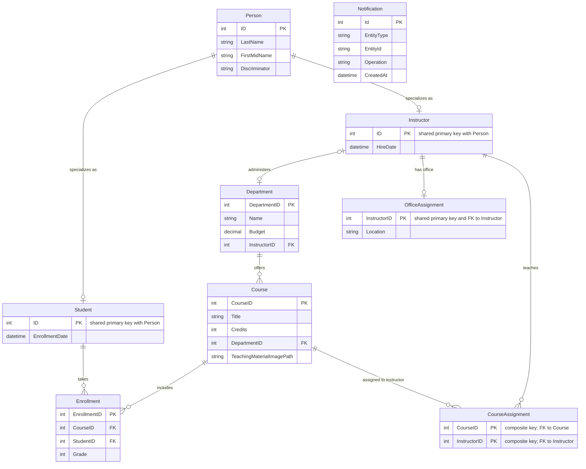

# Data Architecture & Persistence Layer

The application stores university people, courses, departments, enrollment records, and notifications in SQL Server through EF Core. Its model includes shared-table inheritance for people and an explicit join entity for instructor/course assignments.

## Database Configuration

| Service/Module | DB Type | Profile | Driver | Connection | Migration Tool |
|---|---|---|---|---|---|
| ContosoUniversity | SQL Server LocalDB | Default | Microsoft.Data.SqlClient 2.1.4 | `DefaultConnection` in Web.config; integrated security | EF Core Tools package is declared; startup seeding is implemented in code |

`Global.asax.cs` invokes the initializer at application start. No environment-specific database profiles or checked-in migration scripts were identified.

## Data Ownership per Service

| Service | Tables Owned | ORM Framework | Caching | Notes |
|---|---|---|---|---|
| ContosoUniversity | Person, Department, Course, Enrollment, CourseAssignment, OfficeAssignment, Notification | EF Core 3.1 | None identified | One application and one SQL Server database own all entities |

## Entity Model

`SchoolContext` configures `Person` using table-per-hierarchy inheritance, a composite key for `CourseAssignment`, and a one-to-one relationship between `Instructor` and `OfficeAssignment`. `Enrollment` relates students and courses. The context configures date-time properties as SQL Server `datetime2`.

## Key Repository Methods

| Service | Repository | Notable Methods | Purpose |
|---|---|---|---|
| ContosoUniversity | `SchoolContext` (`Data/SchoolContext.cs`) | EF Core `DbSet` queries and `SaveChanges` calls from controllers | Provides direct ORM access; no separate repository interfaces or custom query repository classes were found |
| ContosoUniversity | `SchoolContextFactory` (`Data/SchoolContextFactory.cs`) | `Create()` | Constructs a context using the configured SQL Server connection |

## Caching Strategy

No application-level cache, distributed cache, query-result cache, or cache TTL configuration was identified. EF Core tracks entities within each context lifetime; controllers create and dispose their contexts per request.

## Data Ownership Boundaries

The application uses a single shared SQL Server database and one EF Core context; there are no independently deployed services or service-to-service database calls. Controllers query and update the same context directly. Instructor-to-course associations are represented by `CourseAssignment`, while student/course associations are represented by `Enrollment`; no CQRS or cross-service aggregation pattern was found.

### Data Classification & Sensitivity

| Entity | Sensitive Fields | Classification (PII/PHI/PCI/None) | Controls in Place |
|---|---|---|---|
| Person / Student | Names and enrollment information | PII | No field-level masking or application-level encryption identified |
| Instructor | Name and employment dates | PII | No field-level masking or application-level encryption identified |
| Department / Course | Department budget, course details | None identified | No special controls identified |
| Enrollment | Student-course association and grade | Education record / sensitive student data | No field-level masking or application-level encryption identified |
| Notification | Creator name, entity identifiers, and change summaries | PII may be present | No field-level masking or application-level encryption identified |

No payment-card data was found in the entity model. The checked-in SQL Server connection uses integrated security; database encryption-at-rest settings are not specified in the application configuration.
