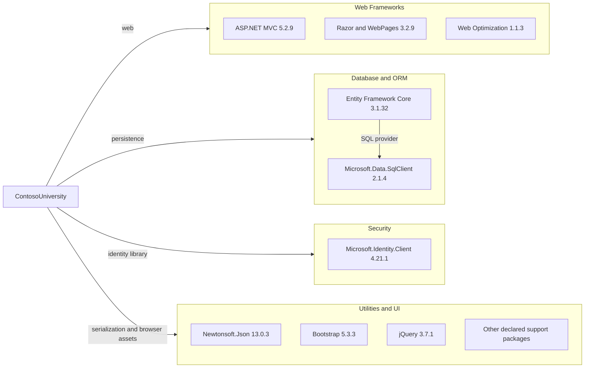

# Dependency Map

ContosoUniversity declares 45 NuGet packages in `packages.config`; the diagram highlights the principal runtime dependencies and groups supporting packages by function.

## Dependencies

### Dependency Summary

| Category | Count | Key Libraries | Notes |
|---|---:|---|---|
| Web Frameworks | 4 | ASP.NET MVC 5.2.9, Razor/WebPages 3.2.9, Web Optimization 1.1.3 | Classic ASP.NET MVC stack |
| Database / ORM | 10 | EF Core 3.1.32, SQL Server provider 3.1.32, SqlClient 2.1.4 | EF Core packages share the 3.1.32 version |
| Security | 1 | Microsoft.Identity.Client 4.21.1 | Declared package; no usage in application source was identified |
| Utilities | 30 | Newtonsoft.Json 13.0.3, Bootstrap 5.3.3, jQuery 3.7.1, WebGrease 1.5.2 | Includes framework support and browser packages |

### Version & Compatibility Risks

The project targets .NET Framework 4.8 and uses ASP.NET MVC 5.2.9 and EF Core 3.1.32, a legacy framework/library combination with migration compatibility work likely required. EF Core 3.1 is out of support. The declared Microsoft.Data.SqlClient 2.1.4 version is affected by CVE-2024-0056; the advisory lists 2.1.7 as the first patched version in the applicable range.

### Notable Observations

- `packages.config` is the package manifest; versions are pinned per package rather than centrally managed.
- Several EF Core and `Microsoft.Extensions.*` packages are individually declared at 3.1.32.
- The project declares packages such as Microsoft Identity Client but does not show corresponding use in the application source.

## Test Dependencies

| Framework | Version | Notes |
|---|---|---|
| None detected | — | No test-scoped NuGet packages were declared in `packages.config`. |

Total test-scope dependencies: 0

No test dependencies were detected in the application package manifest.
